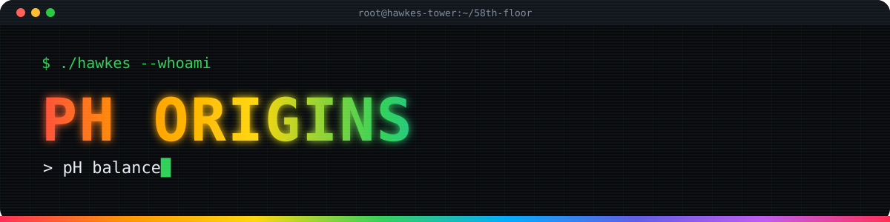

<div align="center">



<a href="https://phorigins.com"></a> <a href="https://github.com/jgriffith3433/phoriginswebsite"></a> <a href="https://github.com/jgriffith3433/phoriginswebsite"></a> <a href="https://hawkesbiomedical.com"></a>

### 🌈 **PH BALANCE** 🌈

</div>


## ⚡ `$ cat WHOAMI`

> **One night in Hawkes Tower: the board meets, something below writes back, and the chairman goes down to find it. A third-person story game with its own level editor.**

```diff
+ repo     phoriginswebsite
+ live     https://phorigins.com
+ stack    Babylon.js 7 · Vite · TypeScript
+ part of  the Hawkes universe: 9 products, 3 engines, one H
```


## 🧬 **THE H** · the whole machine on one screen

```
   ░░ WHO ASKS STUDIO ░░                         ░░ WHO ASKS GEN ░░
   the owner · testers · the clock               editors · game tools · the portal
              │                                               │
   ┏━━━━━━━━━━▼━━━━━━━━━━┓      jobs ━━━━━▶      ┏━━━━━━━━━━━━▼━━━━━━━━━━━━┓
   ┃   HAWKES  STUDIO    ┃                       ┃       HAWKES  GEN       ┃
   ┃   decides           ┃      ◀━━━━━ evidence  ┃       makes             ┃
   ┃   tasks · judges    ┃                       ┃   queue · router · lib  ┃
   ┗━━━━━━━━━━┳━━━━━━━━━━┛                       ┗━━━━━━━━━━━━┳━━━━━━━━━━━━┛
              ▼                                               ▼
   ░ six AI harnesses ░                          ░ rented GPUs · CPUs · browsers ░
   commits ▶ dev ▶ beta ▶ main ▶ 🌐 live          files kept forever, by their content
```

**One side decides, one side makes, and they meet in exactly one place.** Files never cross the bar, only their ids. Nothing ships until evidence about that exact commit has come back.


## 💊 **THE PRODUCT LINE** · presented as medicine, played as games

| Product | Sold as | Live | Repo |
|:--|:--|:--|:--|
| Hawkes Biomedical | *the parent company* | [hawkesbiomedical.com](https://hawkesbiomedical.com) | [`hawkesbiomedical`](https://github.com/jgriffith3433/hawkesbiomedical) |
| **➤ PH Origins** | *pH balance* | [phorigins.com](https://phorigins.com) | [`phoriginswebsite`](https://github.com/jgriffith3433/phoriginswebsite) |
| Sick Of It | *single-use fever shots* | [sickofitgame.com](https://sickofitgame.com) | [`sickofitgamewebsite`](https://github.com/jgriffith3433/sickofitgamewebsite) |
| Dose Of Destruction | *cytotoxic dose* | [doseofdestruction.com](https://doseofdestruction.com) | [`doseofdestructionwebsite`](https://github.com/jgriffith3433/doseofdestructionwebsite) |
| Yooba Land | *hyporexia support* | [yoobalandgame.com](https://yoobalandgame.com) | [`YoobaLandGame`](https://github.com/jgriffith3433/YoobaLandGame) |
| I Can Be | *AI-assisted full-body assessment* | [icanbe.ai](https://icanbe.ai) | [`icanbeaiwebsite`](https://github.com/jgriffith3433/icanbeaiwebsite) |
| The Place Department | *HIPAA-compliant document storage* | [theplacedepartment.com](https://theplacedepartment.com) | [`theplacedepartmentwebsite`](https://github.com/jgriffith3433/theplacedepartmentwebsite) |
| Imagine Live TV | *live medical education* | [imaginelivetv.com](https://imaginelivetv.com) | [`imaginelivetvwebsite`](https://github.com/jgriffith3433/imaginelivetvwebsite) |
| Hawkes Games | *laboratory services* | [hawkesgames.com](https://hawkesgames.com) | [`hawkesgenwebsite`](https://github.com/jgriffith3433/hawkesgenwebsite) |

## 🛠️ **THE ENGINES** · infrastructure, not products

| Engine | Verb | What it is | Live |
|:--|:--|:--|:--|
| Hawkes Studio | **decides** | the manager: Talk, the roadmap, AI agents, playtests, judges, the gate to live | [studio.hawkesgen.ai](https://studio.hawkesgen.ai) |
| Hawkes Gen | **makes** | the maker: one job queue, ~100 generative tools, rented GPUs, a library kept by content hash | [hawkesgen.ai](https://hawkesgen.ai) |
| Hawkes Net | **connects** | multiplayer: tickets, rooms, peer-to-peer with a relay behind it | [net.hawkesgen.ai](https://net.hawkesgen.ai) |


## 🚦 **THE LANES**

```
  dev ──▶ beta ──▶ main
  │       │        └─ 🌐 the live site. Moves only on the owner's word.
  │       └─ 🧪 a private copy, played and judged before anything ships
  └─ 💻 where work happens
```

Every repo has the same six buttons: `dev.bat` · `deploy-beta.bat` · `deploy-prod.bat` · `status.bat` · `links.bat` · `sync.bat`. Addresses and commands for this repo are in [`LANES.md`](LANES.md); the rules for agents are in [`AGENTS.md`](AGENTS.md).


## 📜 **THIS REPO** · the original README, kept

Third-person browser game for **PH Origins**: Pierce Hawkes, the Apex Peak boardroom, and what is locked on basement **B3**.

Built with [Babylon.js](https://www.babylonjs.com/) 7, Vite, and TypeScript. Play it in the browser — no install, no Unity player.

## Play locally

```bash
npm install
npm run dev
```

Then open:

- [http://127.0.0.1:5173/](http://127.0.0.1:5173/) — landing page
- [http://127.0.0.1:5173/game.html](http://127.0.0.1:5173/game.html) — game
- [http://127.0.0.1:5173/devtools.html](http://127.0.0.1:5173/devtools.html) — level editor

```bash
npm run build      # writes static site into play/
npm run preview    # serve the build (port 4173)
```

## Controls

| Input | Action |
|---|---|
| WASD | Move |
| Mouse | Look (Y axis inverted) |
| Space | Jump |
| I | Inventory (pistol draw / holster from the weapon slot) |
| Click | Fire when the pistol is drawn |
| Start | Begin once loading finishes |

On a phone or tablet, on-screen sticks and buttons appear.

## What’s in the game right now

**The Apex Peak (Level 1)** — Hawkes Tower, 58th floor. Sit the board meeting, watch it fall apart, take the window, the terminal, then the elevator to B3. No combat.

**B3 (Level 2)** — Basement lab. Door reveal and vat beats are in; art and voice-over are still being filled in. No combat.

**The Return (Level 3)** — B3 after the vat. The creature is gone, the glass is broken, and Pierce is the changed body. Get to the elevator, take Hale's call in the pipe hall, ride back to the 58th floor, and look in the office mirror. No combat. Powers come later.

The title screen looks out over a night-city skybox until you press Start (the button stays on **Loading…** until Pierce and the board are actually animated — no T-pose flash).

## Repo map

| Path | Purpose |
|---|---|
| `src/main.ts` | Game loop, story sequence, HUD, input |
| `src/game/` | Player, camera, NPCs, cutscenes, weapons, scene load |
| `src/editor/` | Dev Tools editor |
| `levels/` | Level JSON (`apex-peak.json`, `b3-basement.json`, library) |
| `cutscenes/` | Timed dialogue / camera / audio scripts |
| `assets/` | Runtime models (GLB), textures, audio |
| `game.html` | Game shell + HUD CSS |
| `index.html`, `about.html`, `characters.html` | Marketing site (home, story, cast) |
| `devtools.html` | Editor shell |
| `tools/` | FBX→GLB, animation bake, office prop kit, texture compress |
| `play/` | **Build output** — do not edit by hand |

Character and prop **sources** live in the sibling folder `phoriginsassets` (not this repo). This site only ships converted GLBs and compressed textures.

## Levels and props

A level is a JSON file in `levels/`. The game and Dev Tools both load that file. They do not run Blender at play time.

**Reload Dev Tools after a level file changes, and do it before you click in the scene.** The editor keeps whatever it loaded and saves that copy back. An old tab will overwrite a hallway that was just filled in.

### Reuse what is already built

Apex Peak’s office kit is the starting set for the next floor: doors, a water cooler, filing cabinets, plants, a credenza, chairs, waste bins, a carpet runner, desk clutter, and a wall directory. The GLBs are in `assets/models/`. Their ids are in `assets/asset-library.json` (`asset-office-door`, `asset-water-cooler`, and the rest). Drag one from the Dev Tools project tree into the viewport, or copy an entry in the level’s `assets` list.

The runner, bins, clutter, and directory are visual. Any other placed model blocks the player. To leave a new prop walk-through, add its library id to `WALK_THROUGH` in `src/game/sceneData.ts`.

Prop front faces **−Z** when yaw is `0`. Turn by `π` to face the opposite way, and by `±π/2` to face along X. Sizes, the carpet scale, and the Apex Peak marks to leave clear (window stand, office chair, board seats, elevator) are in [`AGENTS.md`](./AGENTS.md) under **Props and new levels**.

Hall walls on Apex Peak use the plaster material `mat-office-wall`. The wood kick along the bottom is a thin `structure-wall` with `mat-wood-desk`, not a separate model.

### Rebuild or add a mesh

`tools/build_office_dressing.py` is the Blender script for that kit. The editable file is `phoriginsassets/models/office-dressing.blend`.

```text
blender -b --python tools/build_office_dressing.py
```

That refreshes the GLBs only. It does not move anything in the level. Add a new prop in that script (or a sibling under `tools/`), export the GLB to `assets/models/`, and register an id in `assets/asset-library.json`. Keep `.blend` files in `phoriginsassets`. One saved under `assets/` ships in the production build.

Dev Tools → **Link Blender** (with `npm run dev` running) opens Blender for a one-off model. Character, pistol, and creature clips stay on `npm run bake:anims`.

### Add a level

1. Create `levels/<id>.json` and add a row to `levels/level-library.json`. Story levels need `"combat": false`. A slot that is not playable yet gets `"comingSoon": true`.
2. Copy that row into `FALLBACK_LIBRARY` in `src/game/levels.ts`.
3. Dress the rooms with the existing prop ids before making new models.
4. Reload Dev Tools, then reload the game.

### Useful npm scripts

| Script | Does |
|---|---|
| `npm run dev` | Vite + editor import APIs |
| `npm run build` | Typecheck and emit `play/` |
| `npm run textures` | Compress / register materials |
| `npm run bake:anims` | Bake Mixamo clips into character GLBs (needs Blender) |
| `npm run convert:fbx` | FBX → GLB helper |

## Content notes

Board VO and SFX are under `assets/audio/`. Mix volumes live in cutscene JSON and in the level’s **music** trigger (`room-tone.mp3` on Apex Peak). Dialogue should stay louder than the bed.

Characters are Mixamo-derived GLBs. Pierce is `ch33`; a later transform uses `ch44` (not swapped in yet). Board NPCs are the other `ch*` models.

## Contributing (this project)

- Prefer small, playable changes; verify in `/game.html`, not only a screenshot.
- Keep combat off on story levels unless design says otherwise.
- If you change how loads, clips, or asset IDs work, update [`AGENTS.md`](./AGENTS.md) so the next editor session stays oriented.

[`AGENTS.md`](./AGENTS.md) is the longer brief for coding agents (architecture, pitfalls, clip names, Act I flow).


<div align="center">

**🏢 Hawkes Tower · 58th floor · "We do not pitch a cure. We own the category."**

<sub>Hawkes Biomedical and every product in its line are a work of fiction. Built by one person and a great many agents.</sub>

</div>
